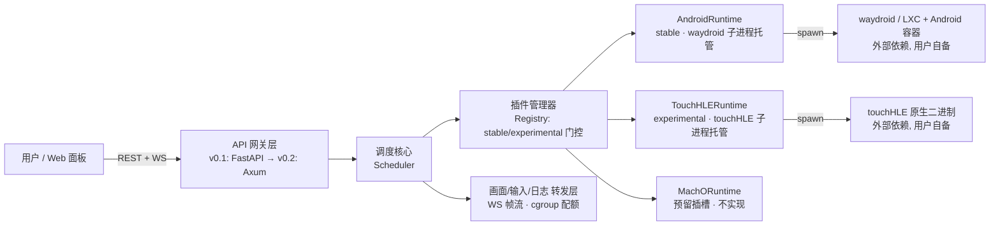

# 00 · 整体架构（交付件 1）

> UniOrchestrator v0.1 — 自研插件化跨平台应用编排调度框架
> 原则：只参考 ApkStart / Waydroid / Anbox / Darling / touchHLE 的**设计思路**，
> 不复制、不移植上游源码；上游全部作为**外部独立程序以子进程方式托管**，协议与代码双向隔离。

## 1. 架构思维导图

## 2. 模块划分（目录）

| 模块 | 文件 | 职责 |
|---|---|---|
| 抽象接口 | `unio/types.py` | AppRuntime 协议 + 公共结构体（InstanceId/配额/窗口/输入/帧流） |
| 插件管理 | `unio/registry.py` | 运行时注册、stable/experimental 门控（env `UNIO_EXPERIMENTAL`） |
| 调度核心 | `unio/scheduler.py` | 实例生命周期：create/start/stop/status，实例表，日志环 |
| Android 后端 | `unio/runtimes/android_rt.py` | waydroid 子进程托管（stable），二进制缺失时降级 `missing_binary` |
| touchHLE 后端 | `unio/runtimes/touchhle_rt.py` | touchHLE 子进程托管（experimental，默认关闭），参数白名单 |
| 参数白名单 | `unio/whitelist.py` | 仅放行 touchHLE 官方 OPTIONS_HELP.txt 公开参数，拒绝任意注入 |
| API 网关 | `unio/gateway.py` | REST 路由 + WS 帧流 + 内嵌面板（默认仅绑 127.0.0.1） |
| Web 面板 | `web/index.html` | 实例管理/启停/画面预览/输入/日志/插件查询 |
| Mock 后端 | `unio/runtimes/mock.py` | 零依赖演示后端，用于无 waydroid/touchHLE 环境下验证管线 |

## 3. 依赖边界（本框架 vs 外部依赖）

| 层 | 归属 | 说明 |
|---|---|---|
| 调度器 / 插件管理器 / API 网关 / 面板 | **本框架（MIT，自研）** | 全新代码，不含量子片段 |
| waydroid / LXC / Android 容器镜像 | 外部依赖（上游协议各自独立） | 用户自备；框架只 spawn 子进程 + 转发参数 |
| touchHLE 二进制 | 外部依赖 | 用户自备；框架只 spawn + 白名单参数 |
| Python 标准库 / FastAPI | 运行依赖 | 开源库，非上游运行时 |

**边界铁律**：本仓库不出现任何上游源码文件；README 附上游清单表（项目/仓库/协议）；
不静态链接、不复制、不修改上游二进制（内存补丁/patch 明确禁止）。

## 4. 平台管控矩阵（v1 门控）

| 能力 | Linux（v1 stable） | Windows（roadmap） | macOS（roadmap） |
|---|---|---|---|
| AndroidRuntime（waydroid 托管） | ✅ v1 | ❌ 不可行 → 换宿主方案（roadmap） | ⚠️ 受限 |
| TouchHLERuntime（experimental） | ✅ 仅 dev 开关 | ❌ | ❌（touchHLE 目标平台为 Linux/x86） |
| WS 画面帧流 + Web 面板 | ✅ v1 | roadmap | roadmap |
| 原生窗口层（Win32/Cocoa/X11-Wayland） | n/a（宿主自绘） | roadmap | roadmap |
| MachORuntime | 预留插槽（不实现） | 预留 | 预留 |
| cgroup v2 资源配额 | ✅ best-effort | ❌ | ❌ |

**门控规则**：stable 构建默认只编 AndroidRuntime（+Mock）；
touchHLE 插件仅当 `UNIO_EXPERIMENTAL=1` 时注册，stable 包不启用；
Mach-O 仅保留 `AppRuntime` 接口插槽，无实现代码。

## 5. 交付顺序对照（按规格文档 8 件）

1. ✅ 本文（架构/模块/边界/门控）
2. ✅ `docs/01-interfaces.md`（抽象接口文档，与 `unio/types.py` 一一对应）
3. ✅ `unio/scheduler.py` + `unio/registry.py`（调度核心骨架）
4. ✅ `unio/gateway.py`（路由/流转发；鉴权 v1 = 仅绑回环 + roadmap 令牌）
5. ✅ `unio/runtimes/touchhle_rt.py` + `unio/whitelist.py`（子进程适配 + 白名单）
6. ✅ `web/index.html`（内嵌面板）
7. ✅ `README.md`（免责/依赖协议清单/版本路线）
8. ✅ `docs/08-security.md`（白名单/子进程隔离/沙箱配额）

## 6. 原型 → Rust 迁移路线

- v0.1（现在）：Python 原型验证 架构跑通（接口/门控/白名单/WS 管线 全量执行）
- v0.2：同构迁移 Rust（`types.py` → `types.rs` trait，`gateway.py` → Axum），Python 版退役
- 迁移不改语义层：AppRuntime 方法签名、白名单集合、门控 env 名 保持逐一对应
